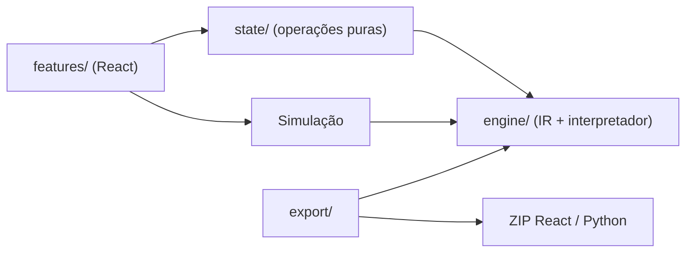

<div align="center">

# ⚡ Flowforge

**Editor visual de fluxos de telas, lógica e integrações — com simulação em tempo real e exportação de código.**

[](https://github.com/centraldodev/flowforge/actions/workflows/deploy.yml)
[](https://github.com/centraldodev/flowforge/actions/workflows/ci.yml)
[](LICENSE)


[**▶ Abrir demo**](https://centraldodev.github.io/flowforge) · [Funcionalidades](#-funcionalidades) · [Começando](#-começando) · [Arquitetura](#-arquitetura)

</div>

---

## ✨ Funcionalidades

- **Canvas visual** com blocos conectáveis por portas de execução e de dados (React Flow).
- **Telas como abas** — cada tela agrupa seus campos e botões; novos blocos entram na aba ativa.
- **Simulação em tempo real** nos formatos **Mobile**, **Web** e **Desktop**, usando o mesmo interpretador do código exportado.
- **Navegação por resultado** — transições entre telas disparadas por `true`, `false` ou `sempre`.
- **Exportação** para projeto **React/TypeScript (Vite)** ou **Python/Tkinter** em um ZIP.
- **Desfazer/refazer**, salvamento automático no navegador e importação/exportação em JSON.
- **Validação** do grafo com alertas de conexões inválidas e regras sobrepostas.

### Biblioteca de blocos

| Categoria | Blocos |
|---|---|
| **Interface** | Tela, Botão, Campo de entrada |
| **Lógica** | Função, Condição, Autenticação, Tratamento de erro, Navegação |
| **Dados** | Banco de dados, Requisição API |

## 🚀 Começando

**Requisitos:** Node.js `>= 20.19` e npm.

```sh
git clone https://github.com/centraldodev/flowforge.git
cd flowforge
npm install
npm run dev
```

### Scripts

| Comando | Descrição |
|---|---|
| `npm run dev` | Servidor de desenvolvimento |
| `npm run build` | Typecheck + build de produção em `dist/` |
| `npm run preview` | Serve o build localmente |
| `npm test` / `npm run test:watch` | Testes do interpretador e operações do grafo |
| `npm run lint` / `npm run lint:fix` | ESLint |
| `npm run format` / `npm run format:check` | Prettier |
| `npm run typecheck` | Checagem de tipos |
| `npm run check` | Lint + formatação + tipos + testes (o mesmo que o CI roda) |

## 🧭 Como usar

1. **Novo projeto** (menu esquerdo) cria um canvas vazio; **Abrir projeto** carrega um JSON.
2. Clique em um bloco da biblioteca para adicioná-lo à tela ativa e arraste para posicionar.
3. Configure o bloco selecionado no painel direito (propriedades e conexões).
4. Arraste de uma porta de saída até uma porta de entrada para conectar. Cada saída de execução aceita um destino e cada entrada de dados aceita uma origem.
5. Em uma tela, abra **Conexões → Navegação entre telas** para definir transições por resultado.
6. Clique em **Simular** e escolha a plataforma. Login de exemplo: `demo@exemplo.com` / `123456`.
7. **Exportar projeto** baixa o ZIP React/TypeScript ou Python/Tkinter.

**Atalhos:** `Backspace` exclui o bloco selecionado · `Esc` fecha painéis flutuantes · desfazer/refazer pela barra do canvas.

## 🏗 Arquitetura

```
src/
├── engine/      # IR do grafo, catálogo, portas, validação e interpretador (TypeScript puro, sem React)
├── state/       # Operações puras no grafo, histórico (undo/redo), persistência e simulação
├── features/    # canvas · sidebar · inspector · preview · project
├── components/  # Componentes genéricos (Modal, Toast, PropertyField)
├── export/      # Geradores React/TypeScript e Python/Tkinter + templates
├── styles/      # CSS por área da interface
└── app/         # Montagem da aplicação (App, Header)
tests/           # Testes com node:test
```



O grafo é independente da linguagem de destino. Para adicionar uma nova linguagem, implemente um exportador em `src/export/` que interprete tipos de bloco, propriedades e conexões, e registre a opção no modal de exportação.

## ⚠️ Limitações atuais

- Telas usam layout simples em coluna; não há posicionamento livre de elementos.
- **API** retorna o JSON configurado, sem requisições reais. **Banco** é em memória (listar/inserir).
- **Autenticação** e provedores OAuth são simulados — não use dados reais nem trate como modelo de produção.
- Execuções têm limite de 100 passos para conter ciclos.
- Não há geração de apps nativos Android/iOS.

## 🤝 Contribuindo

1. Crie uma branch a partir da `main`.
2. Use [Conventional Commits](https://www.conventionalcommits.org/pt-br/) (`feat:`, `fix:`, `refactor:`…).
3. Rode `npm run check` antes de abrir o PR — o CI executa as mesmas verificações.

## 📄 Licença

Distribuído sob a licença [MIT](LICENSE).
